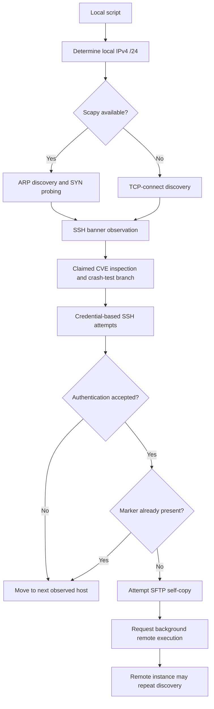

<div align="center">

# WYRM


> **“IT WAS AN ALASKAN BULL WORM!”**


 (https://knowyourmeme.com/photos/1512528-spongebob-squarepants).

</div>

> [!CAUTION]
> **Active self-propagation and service-disruption risk.** The supplied `wyrm.py` attempts local network discovery, SSH authentication using hard-coded credentials, SFTP self-copying, and background execution on other hosts. It also contains code intended to send malformed SSH traffic that could interrupt services. **Do not execute it on real, shared, production, public, or unauthorized networks.** It has no target allowlist, no reliable kill switch, and no isolation boundaries.

## Overview

`wyrm.py` is a single-file Python sample for studying **how an SSH-focused network worm attempts to spread**. It combines network discovery and SSH service enumeration with a credential-based copy-and-execute mechanism. It also **claims** to test `CVE-2026-55200` by constructing malformed SSH traffic. That claim is **not validated by this code**, and the vulnerability affects the **libssh2 client**, rather than a standard SSH server daemon.

This repository's purpose is to **document the sample's behavior, limitations, and defensive indicators**—not to treat it as a reliable exploit or an appropriate network scanning tool.

### Behavior at a glance

| Component | What the supplied code attempts | Important qualification |
| --- | --- | --- |
| Local addressing | Infers an outbound IPv4 address and assumes a local `/24`. | The `/24` is inferred, not learned from an interface mask. |
| Scapy discovery | Sends a broadcast ARP sweep to identify responding hosts. | Requires raw-packet access and works on the local broadcast domain. |
| Fallback discovery | When Scapy is unavailable, uses concurrent TCP connection attempts to SSH port 22. | A TCP response is not a complete host inventory. |
| SSH service check | Uses a SYN-based probe on discovered hosts when Scapy is installed. | Port-open observations do not imply vulnerability. |
| Banner inspection | Reads an SSH identification string and looks for `libssh2_`. | A banner is not a reliable inventory of the client's linked library. |
| Claimed CVE test | Defines malformed-packet generation and a service-availability check. | This does not establish exploitation of `CVE-2026-55200`. |
| Credential attempts | Tries a small hard-coded list of username/password pairs via Paramiko. | This is an authentication attack, separate from the CVE. |
| Self-transfer | Attempts to write a copy of the running script to a remote temporary path over SFTP. | Depends on successful SSH authentication and remote permissions. |
| Duplicate marker | Looks for a file intended to mark a visited system. | A marker is not proof that execution or compromise succeeded. |
| Remote process | Requests background Python execution of the transferred file. | Does not install Python, Scapy, or Paramiko remotely. |
| Repeated discovery | A successfully launched remote copy would attempt discovery on its host's network. | Continued propagation is **not demonstrated** by the provided script. |

## Conceptual lifecycle



> [!IMPORTANT]
> This flowchart describes the **program's intended control flow**, not a proven exploit chain. The CVE branch is not normally reachable as written; see **Accuracy and implementation findings** below.

## Source components

| Functions or identifiers | Role |
| --- | --- |
| `local_ip`, `arp_sweep`, `tcp_connect_sweep` | Network addressing and discovery |
| `ssh_open`, `ssh_banner` | SSH reachability and initial banner collection |
| `libssh2_version`, `cve_candidate` | Claimed library-version identification and gate |
| `malformed_packet`, `trigger_cve_2026_55200` | Malformed SSH traffic and attempted service-disruption observation |
| `port_closed`, `wait_for_ssh` | Simple reachability checks |
| `infect_by_creds`, `deploy`, `self_bytes` | SSH authentication, file transfer, remote launch |
| `MARKER`, `REMOTE_WORM` | Files used by the sample to track visits and stage itself |

## CVE-2026-55200: what is actually known?

`CVE-2026-55200` is a reported **out-of-bounds write in the libssh2 library**, associated with unchecked SSH `packet_length` handling. Public vendor guidance identifies **client-side exposure**: a vulnerable **libssh2 client must receive malicious SSH traffic from an attacker-controlled or compromised SSH server**. The sample instead sends packets **to an SSH server** and interprets that server's silence as proof of a libssh2 vulnerability. Those are different threat models.

- A remote SSH server's version banner does **not** demonstrate which libssh2 client version an application uses.
- A temporarily unreachable SSH port is **not proof of heap corruption, a CVE trigger, or remote code execution**.
- A source-version threshold is not sufficient for all distributions because vendors can backport patches.
- Package security advisories and dependency inventories are better evidence of exposure than SSH identification banners.

**References:** [Red Hat CVE analysis](https://access.redhat.com/security/cve/cve-2026-55200) · [Ubuntu security notice](https://ubuntu.com/security/CVE-2026-55200) · [Debian security tracker](https://security-tracker.debian.org/tracker/CVE-2026-55200) · [Upstream patch](https://github.com/libssh2/libssh2/commit/97acf3dfda80c91c3a8c9f2372546301d4a1a7a8)

## Accuracy and implementation findings

These observations concern the **exact supplied source**, not a tested or repaired version:

1. **Immediate startup error:** `ME = os.path.abspath(sys.argv[0])` references `sys`, but there is no `import sys` in the pasted code. The program therefore fails during module initialization.
2. **Incorrect CVE target:** the claimed exploit path models the flaw as an SSH-server issue even though authoritative analysis describes a vulnerable libssh2 **client** receiving a malicious server response.
3. **CVE branch is normally bypassed:** `cve_candidate()` returns a candidate only when the SSH port appears **closed**. The discovery path selects reachable SSH targets, so the candidate test is ordinarily skipped.
4. **Version limit is unused:** `VULN_MAX = (1, 11, 1)` is declared, but the code never compares the parsed version to that limit.
5. **No patching behavior:** although the module header says the credential path “patches hosts,” the provided functions do not install a security patch.
6. **Malformed packet and crash attribution are unverified:** a subsequent SSH timeout is a reachability observation, not proof that a particular memory-safety flaw was triggered.
7. **Remote prerequisites are assumed:** successful file upload does not ensure the transferred copy can import its dependencies, access raw sockets, or continue operating.
8. **Unsafe scope and authentication defaults:** the code has no explicit approved-target list and uses permissive SSH host-key acceptance. These are material risks if executed outside a fully isolated test environment.

**Assessment:** This is a **high-risk, incomplete self-propagating proof-of-concept sample**, not a verified or production-ready CVE exploit.

## Defensive detection opportunities

| Signal | Investigative interpretation |
| --- | --- |
| Short bursts of ARP requests over local IPv4 ranges | Possible network enumeration |
| Many SYN or TCP-connect attempts to port 22 | SSH-service discovery |
| Multiple failed SSH logins using common/default usernames | Credential guessing |
| Unusual SSH identification strings or malformed transport frames | Possible protocol fuzzing or exploit attempts |
| SSH sessions followed by file writes under `/tmp` | Remote tool staging |
| New background Python processes spawned from an SSH session | Potential unauthorized remote execution |
| Repetition of the above sequence from multiple endpoints | Potential lateral movement or propagation |

### File and process artifacts

The sample defines these artifacts:

```text
/tmp/.worm4_marker     # Local or remote marker
/tmp/worm4.py          # Remote self-copy destination
python3               # Interpreter requested for remote execution
```

These are **indicators to investigate**, not sufficient standalone evidence of infection. Validate with authentication logs, process trees, file provenance, and network captures.

## Defensive recommendations

- Use strong SSH authentication; remove default credentials and disable password authentication where operationally feasible.
- Restrict inbound and lateral SSH access with segmentation and host firewalls.
- Verify SSH host keys in authorized automation; do not automatically trust arbitrary hosts.
- Alert on unusual SSH authentication patterns, `/tmp` script staging, and remote Python launches.
- Inventory software that uses **libssh2 as a client library** and apply the relevant vendor security updates or backports.
- Perform static review or **non-propagating mock simulations** instead of running this sample against live infrastructure.

## Project structure

```text
.
├── README.md
├── wyrm.py                       # Add the separately supplied source file here
└── assets/
    └── wyrm-network-demo.gif    # Included simulated network animation
```

The SpongeBob GIF at the top of this README is **linked from an external site**, not redistributed in the archive. If external images do not load, use the source link beneath it.

## Intended audience and responsible use

For malware analysts, defenders, incident responders, and students studying **network discovery, SSH threat models, and worm behavior**. All examples are for documentation and investigation. A suitable analysis setting is an offline or carefully isolated lab with simulated targets, no route to other networks, and explicit authorization.

No instructions for executing, deploying, or enhancing the active self-propagating code are included.

---

<div align="center">

**WYRM — the worm is a little too enthusiastic about lateral movement. 🪱**

*Research documentation · Simulated animation · Not a validated exploitation result*

</div>
