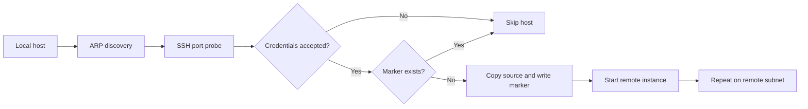

# Wyrm

Illustrative animation — simulated terminal output, not a recording of a live infection.

[!CAUTION]
This repository contains self-propagating code. As written, worm2.py discovers nearby systems, attempts SSH authentication with a short hard-coded credential list, copies itself to systems it can access, and launches additional copies. Do not execute it on production, public, shared, or otherwise unauthorized networks. The program has no target allowlist, kill switch, or scope enforcement.

Overview
worm2.py is a Python research example illustrating how a credential-based SSH worm could move laterally across a local network. It combines Scapy packet crafting and discovery with Paramiko SSH/SFTP functionality. It does not exploit a software vulnerability: its attempted access depends on valid, weak/default credentials already being accepted by SSH servers.

The script is not a safe network scanner. Its discovery phase is followed by automated credential attempts and remote code execution.
Behavior at a glance
Stage	What the supplied code does
Local addressing	Uses a UDP socket to determine the host's outbound IPv4 address.
Host discovery	Broadcasts ARP requests across the inferred local /24 subnet.
SSH probing	Sends TCP SYN packets to port 22 on discovered hosts.
Authentication	Tries three hard-coded username/password pairs against reachable SSH services.
File transfer	Uses SFTP to copy its own source file to a temporary path after successful login.
Duplicate check	Checks for a marker file to avoid repeating work on the same host.
Remote execution	Starts the copied script in the background on the remote system.
Propagation	A new instance attempts the same discovery process from its host's local network.

Conceptual lifecycle

Code layout
.
├── worm2.py                 # Original supplied research sample
├── README.md                # Project documentation
└── assets/
    └── worm2-demo.gif       # Simulated lifecycle animation
Dependencies and assumptions
- Python 3, Scapy, and Paramiko are used by the supplied script.
- The discovery and SYN-probing portions require raw-packet privileges on systems where they execute.
- ARP discovery applies only to the host's local Layer-2 broadcast domain and assumes a /24 IPv4 network.
- The copied program also needs its Python dependencies and appropriate privileges on any remote host. The script does not install these prerequisites.
- Remote SSH access depends on enabled password authentication and accepted credentials.
- The source calls AutoAddPolicy() for SSH host keys, so it does not validate trusted host identity in a secure way.
No execution or deployment instructions are provided here. For analysis, prefer reading the code, reviewing packet captures, or adapting the workflow into a non-propagating mock demonstration in an isolated lab.
Indicators defenders can monitor
Observable	Why it matters
Bursts of ARP requests across a /24 range	Rapid local host enumeration.
Repeated TCP SYNs to port 22	SSH service discovery.
Failed SSH password attempts for privileged/common usernames	Possible credential guessing activity.
SSH logins followed by SFTP uploads into /tmp	Suspicious remote staging behavior.
/tmp/worm2.py	Remote copy path used by the sample.
/tmp/.worm2_marker	Marker path used to record a prior visit.
Background python3 processes spawned from SSH sessions	Potential execution of transferred code.

These are investigative clues, not conclusive proof of compromise. Correlate process, file, authentication, and network telemetry.
Limitations and research notes
- Not a vulnerability exploit: the propagation attempt succeeds only if the script can authenticate to SSH.
- No safe scope boundaries: there is no allowlist or check that a discovered host is part of an authorized test environment.
- No persistence mechanism: the code launches a background process but does not configure startup persistence.
- Incomplete result verification: successful upload and SSH command submission do not prove the remote copy continues running.
- Remote environment sensitivity: missing packages, insufficient privileges, firewalls, host settings, and address assumptions can prevent repeat propagation.
- Marker-file behavior: the marker suppresses repeat attempts, but by itself cannot prove a healthy running instance.
Defensive takeaways
1. Disable SSH password authentication when feasible and require key-based or centrally managed strong authentication.
2. Remove default credentials, restrict privileged SSH logins, and apply rate limiting or account lockout controls.
3. Segment networks and limit lateral SSH connectivity to managed administrative paths.
4. Alert on unusual SSH attempts, unexpected SFTP transfers, and remote Python process launches.
5. Investigate suspicious files and processes with appropriate evidence-handling procedures.
Responsible use
This documentation is intended for malware behavior analysis, defensive research, and controlled cybersecurity education. Use only with explicit authorization and effective isolation; avoid running self-propagating code on networks that can reach devices outside your own test environment.

  WORM2 · Network propagation behavior study · Documentation and animation for educational analysis

